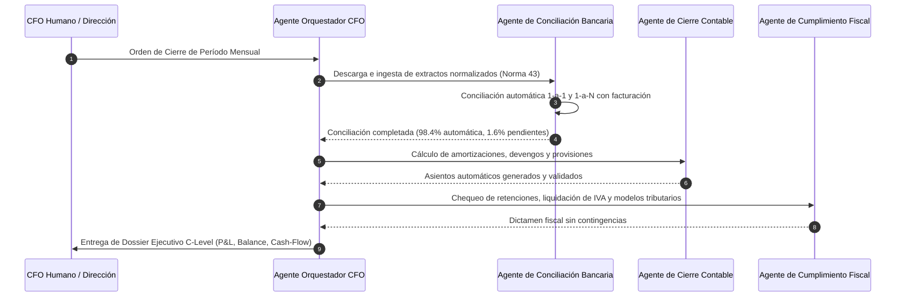

# CFO — Director Financiero Autónomo para PYMEs
### Automatización Integral de Cierres Contables, Conciliación Bancaria y Reporting Ejecutivo

---

## 1. Resumen Ejecutivo (CFO & Strategic Board)

El agente **CFO Autónomo** resuelve de raíz el cuello de botella más crítico de los departamentos financieros: el ciclo de cierre contable mensual y la conciliación de tesorería. Mediante la orquestación de sub-agentes especializados en auditoría contable, clasificación fiscal y proyección de flujo de caja, entrega a la dirección dictámenes financieros rigurosos en tiempo récord.

---

## 2. Flujo del Ciclo de Cierre Mensual Automatizado

---

## 3. Retorno Económico Medible

- **Reducción de coste de cierre**: -90% en horas de consultoría y horas extras contables.
- **Anticipación de liquidez**: Previsión de tesorería a 30, 60 y 90 días con 94% de precisión.
- **Cero contingencias fiscales**: Verificación previa a la presentación ante la Agencia Tributaria.
