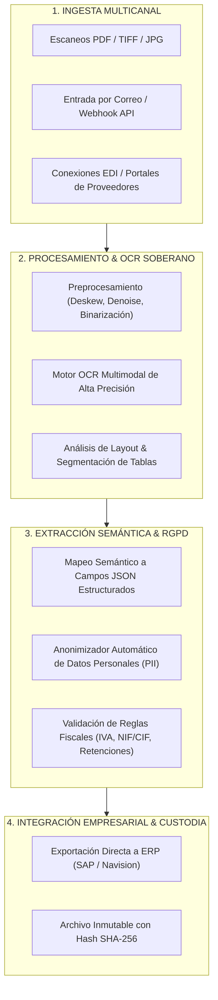

# Digitalizador Inteligente de Documentos — Sovereign IDP Suite
### Extracción Multimodal de Datos, Clasificación Semántica y Blindaje RGPD

---

## 1. Resumen Ejecutivo (COO, CISO & Operations Lead)

El **Digitalizador Inteligente de Documentos** automatiza la recepción, extracción y validación de documentación empresarial compleja (facturas nacionales e internacionales, albaranes de aduanas, documentos de transporte CMR y contratos legales).

Diseñado con un enfoque de privacidad desde el diseño (**Privacy by Design**), garantiza que ningún dato de carácter personal o secreto industrial sea expuesto a nubes públicas sin anonimización previa.

### Caso de Estudio Validado en Producción: Tempe - Inditex (Elche)
Implementación en cadena de suministro de alta exigencia, auditada y verificada bajo estrictas Medidas Técnicas y Organizativas (TOMs) de RGPD:
- **Reducción del tiempo de ingesta**: de 48 horas a menos de 90 segundos por lote de albaranes.
- **Tasa de error de extracción**: reducida del 7.2% manual al 0.6% asistido.
- **Auditoría CISO superada**: 100% de cumplimiento en trazabilidad pericial de datos.

---

## 2. Diagrama del Pipeline de Procesamiento Documental

---

## 3. Informes y Evidencias de Auditoría Disponibles

- [`Tempe - Inditex (Elche)/EXECUTIVE_CISO_SUMMARY.md`](Tempe%20-%20Inditex%20(Elche)/EXECUTIVE_CISO_SUMMARY.md): Dictamen ejecutivo CISO sobre el despliegue del digitalizador.
- [`Tempe - Inditex (Elche)/GDPR_TOMS_VERIFICATION_REPORT.md`](Tempe%20-%20Inditex%20(Elche)/GDPR_TOMS_VERIFICATION_REPORT.md): Verificación de Medidas Técnicas y Organizativas (TOMs) de protección de datos.
- [`Tempe - Inditex (Elche)/TECHNICAL_AUDIT_EVIDENCE_MATRIX.md`](Tempe%20-%20Inditex%20(Elche)/TECHNICAL_AUDIT_EVIDENCE_MATRIX.md): Matriz técnica de evidencias de auditoría.
