# Kronos — Sistema de Gobernanza y Productividad Temporal
### Control de Jornada Legal, Imputación de Proyectos y Auditoría de Eficiencia

---

## 1. Resumen Ejecutivo (Director de Recursos Humanos & Legal Counsel)

**Kronos** es la plataforma enterprise para el registro diario de jornada laboral, control de presencia e imputación de horas a centros de coste y proyectos. Desarrollado en estricta conformidad con el **Real Decreto-ley 8/2019** y la jurisprudencia del Tribunal de Justicia de la Unión Europea (TJUE), garantiza un registro objetivo, fiable y accesible sin invadir la privacidad de los empleados.

---

## 2. Diagrama de Arquitectura Kronos

```mermaid
flowchart LR
    subgraph Empleados ["CANALES DE REGISTRO"]
        WEB["Portal Web Responsive"]
        APP["App Móvil con Geolocalización Opcional"]
        API["Fichaje por Torniquete / Biometría"]
    end

    subgraph BackendKronos ["NÚCLEO KRONOS (BACKEND)"]
        AUTH["Control de Acceso RBAC & MFA"]
        CORE["Motor de Cálculo de Horas & Horas Extra"]
        PROJ["Módulo de Imputación de Costes a Proyectos"]
    end

    subgraph AuditoriaYCompliance ["AUDITORÍA LEGAL"]
        SEAL["Sellado Criptográfico de Fichajes (Anti-Manipulación)"]
        INSPEC["Generador de Informes para la Inspección de Trabajo"]
        HR_REP["Cuadro de Mando de Absentismo y Productividad"]
    end

    Empleados --> BackendKronos
    BackendKronos --> AuditoriaYCompliance
```

---

## 3. Garantías Legales

- **Inmutabilidad de datos**: Una vez registrado un fichaje, no puede ser alterado sin dejar rastro pericial.
- **Disponibilidad para la Inspección de Trabajo**: Exportación inmediata en formato oficial según requerimientos legales.
- **Cumplimiento RGPD**: Separación estricta de datos laborales y biométricos; retención obligatoria durante 4 años.
