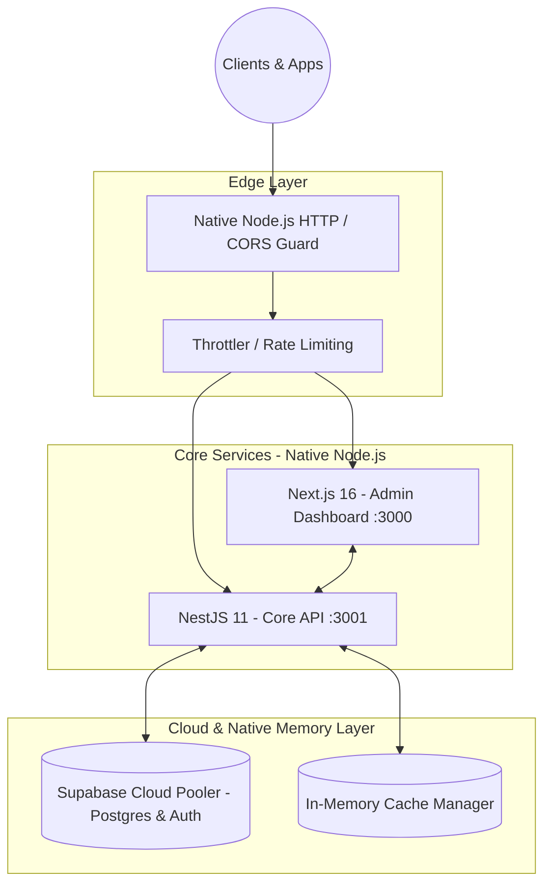

# Kronos Core Platform - Enterprise Architecture (Cero-Docker Native)

## Executive Summary
Kronos is our highly scalable, fault-tolerant enterprise backend and data orchestration platform. It is designed to handle high-throughput operations with 99.99% availability, serving as the central nervous system for our microservices ecosystem. By employing a robust monorepo structure with Next.js 16 (App Router) for internal dashboards and NestJS 11 for strict, type-safe API endpoints, Kronos ensures rapid iteration cycles and uncompromising data integrity.

## Native Zero-Docker Architecture
All services run natively on Windows 11 Enterprise / Node.js v20+ without any Docker daemon or containers:
- **Backend API (`apps/backend`)**: NestJS 11 running natively on `http://localhost:3001`, featuring Throttler rate-limiting, Helmet security headers, and Supabase Auth Bearer Strategy.
- **Frontend Dashboard (`apps/frontend`)**: Next.js 16 running natively on `http://localhost:3000` with offline-first localStorage queue and automatic resynchronization.
- **Persistence Layer**: Direct connection to **Supabase Cloud Pooler** (`aws-0-eu-north-1.pooler.supabase.com`) and in-memory high-speed caching via `@nestjs/cache-manager`.

## High-Level Architecture (C-Level View)

## Quick Start & Verification
- **Interactive Hub**: Double-click `INICIAR_KRONOS_HUB.bat`.
- **Automated Test Suite**: Run `npm test` from the monorepo root.
- **Static Quality Audit**: Run `npm run lint` from the monorepo root.
