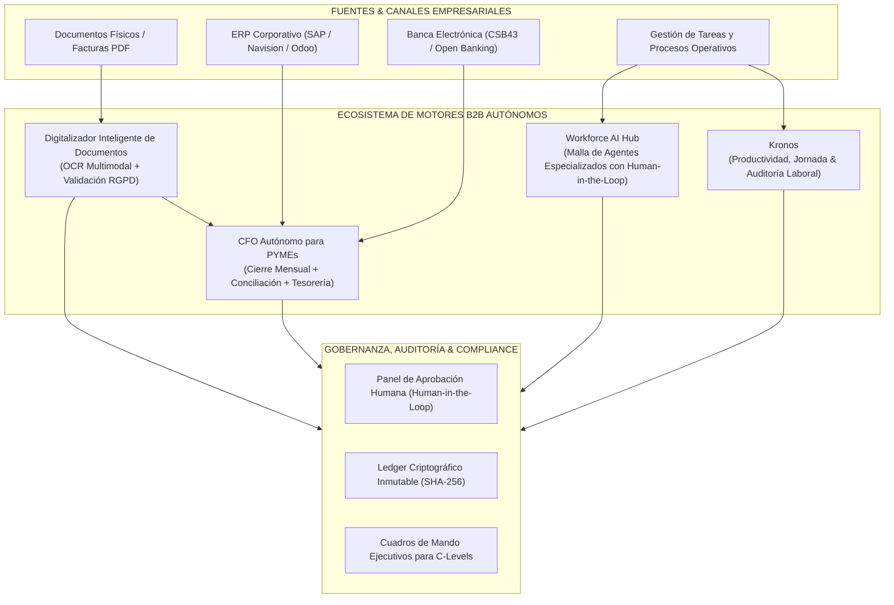

# Enterprise B2B Autonomous Solutions & Operational AI Suite
### Ecosistema B2B de Agentes Autónomos, Finanzas Soberanas y Digitalización Documental

---

## 1. Resumen Ejecutivo (C-Level & Strategic ROI)

La plataforma **Herramientas B2B** integra las cuatro soluciones críticas para la modernización, eficiencia operativa y automatización segura de procesos de negocio corporativos y PYMEs reguladas:

1. **CFO Director Financiero Autónomo**: Automatización end-to-end de cierres contables mensuales, conciliación bancaria, previsión de tesorería y reporting financiero ejecutivo.
2. **Digitalizador Inteligente de Documentos**: Extracción multimodal de información en facturas, albaranes y contratos con validación de cumplimiento RGPD y trazabilidad pericial (con caso real validado en supply chain).
3. **Kronos — Sistema de Gobernanza y Productividad Temporal**: Registro horario inmutable y auditoría laboral conforme al RDL 8/2019 y directivas europeas de trabajo.
4. **Workforce AI Hub**: Orquestador corporativo de agentes autónomos especializados organizados como empleados digitales de alta cualificación.

### Matriz Estratégica de Impacto Directivo

| Rol Directivo | Desafío Operativo | Solución B2B Suite | Impacto Medible / ROI |
|---|---|---|---|
| **CEO / Dirección General** | Cuellos de botella en operaciones manuales y altos costes de estructura. | Despliegue de agentes autónomos colaborativos con supervisión Human-in-the-Loop. | +320% en capacidad de procesamiento sin incrementar plantilla fija. |
| **CFO (Director Financiero)** | Cierres mensuales lentos (10-15 días) y errores en conciliación bancaria. | **CFO Autónomo** conectado a ERP y extractos bancarios multi-entidad. | Cierre contable en < 4 horas; 0 discrepancias de caja. |
| **COO (Operaciones / Supply Chain)** | Cientos de facturas y albaranes en papel/PDF procesados a mano con retrasos. | **Digitalizador Documentos** con OCR soberano y validación de metadatos. | -88% coste por documento procesado; ciclo de pago acelerado. |
| **CISO / DPO (Privacidad & Legal)** | Fuga de datos personales y no conformidad RGPD en facturación y contratos. | Blindaje perimetral, anonimización automática de PII y sellado SHA-256. | 100% de evidencia auditable; riesgo de sanción suprimido. |

---

## 2. Diagrama de Arquitectura Global B2B

---

## 3. Sub-repositorios Incluidos

- [`CFO Director Financiero Autónomo para PYMEs/`](CFO%20Director%20Financiero%20Aut%C3%B3nomo%20para%20PYMEs/README.md): Agente autónomo financiero para reporting ejecutivo, conciliación y tesorería.
- [`Digitalizador Documentos/`](Digitalizador%20Documentos/README.md): Pipeline soberano de ingestión, extracción OCR, estructuración y verificación RGPD de documentos.
- [`Kronos/`](Kronos/README.md): Plataforma integral de gestión del tiempo, control de jornada legal e imputación de proyectos.
- [`Workfoce HUB/`](Workfoce%20HUB/README.md): Malla empresarial de trabajadores digitales coordinados con gobernanza centralizada.
