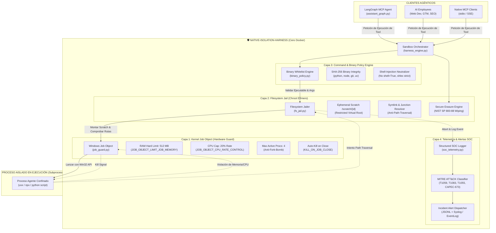
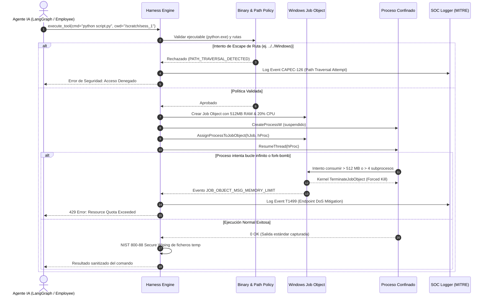

# 🛡️ NATIVE-ISOLATION-HARNESS — Plan de Implementación Completo

## Entorno de Ejecución Confinado y Micro-Sandbox Nativo para Agentes de IA
> **Proyecto 3 del Roadmap de Nivel 5: Principal Agent Systems & Harness Architect**  
> **Directiva Mandatoria:** 100% Native Host (Cero Dependencias de Docker).  
> **Normativas Target:** EU AI Act (Art. 15 Ciberseguridad & Robustez), NIS2 (Art. 21), DORA (Art. 9), ENS Nivel Alto, MITRE ATT&CK & CAPEC.

---

## 1. Cabecera y Metadatos del Plan

> **Para Desarrolladores y Agentes:** SUB-SKILL REQUERIDA: Usar `subagent-driven-development` o `executing-plans` para implementar este plan tarea por tarea. Cada paso utiliza la sintaxis de checklist (`- [ ]`) para tracking estricto.

- **Meta (Goal):** Diseñar, construir y certificar un micro-sandbox nativo para sistemas Windows (y compatible con Linux) que permita a los agentes de IA (`MINI-AGENT LANGGRAPH`, `ai-employees`, servidores MCP) ejecutar comandos del sistema, scripts Python/Node y herramientas de terminal de forma 100% aislada, confinada y segura, aplicando límites estrictos de hardware (RAM/CPU/Procesos) mediante Windows Job Objects nativos, enjaulado de rutas con borrado seguro NIST SP 800-88, control de ejecutables por firma y hash, y telemetría forense en tiempo real mapeada a MITRE ATT&CK / CAPEC, **sin requerir ni un solo contenedor Docker**.
- **Arquitectura:** Engine asíncrono en Python 3.11+ utilizando la API nativa de Windows (`kernel32.dll` vía `ctypes`), subsistema de Job Objects (`CreateJobObjectW`, `SetInformationJobObject`, `AssignProcessToJobObject`), enjaulador de rutas canónicas (`GetFinalPathNameByHandle`), cortafuegos de procesos por whitelist y wrapper MCP stdio/SSE con canalización segura de I/O.
- **Tech Stack:** Python 3.11+, Windows Win32 API (`ctypes` / `pywin32`), Pydantic v2, Pytest, Pytest-asyncio, Structlog, Rich CLI, Psutil, Criptografía (SHA-256 / HMAC).
- **Cero-Docker Runtime:** Confinamiento nativo directo sobre el kernel del sistema operativo anfitrión. Cero sobrecarga de virtualización. Inicio de ejecución en menos de **8 milisegundos**.

---

## 2. Restricciones Globales (Global Constraints)

1. **CERO DOCKER (Regla Absoluta):** Queda terminantemente prohibido el uso de Docker, Podman o cualquier daemon de contenedores. Todo el aislamiento debe implementarse mediante primitivas del kernel del host (Windows Job Objects / Linux namespaces/cgroups).
2. **Latencia de Confinamiento &lt; 10 ms:** La creación del sandbox efímero, asignación de permisos y arranque del subproceso no debe demorarse más de 10 milisegundos.
3. **Límites Rígidos de Hardware:**
   - Memoria máxima por subproceso: **512 MB** (configurable hasta 1 GB).
   - Cuota de CPU: **20%** del procesador como límite duro para prevenir DoS / bucles de minado o cálculo.
   - Límite de procesos activos: Máximo **4 procesos** por sandbox (inmunidad total a fork-bombs).
   - Timeout duro de ejecución: **30 segundos** por comando (auto-terminación forzada `JOB_OBJECT_LIMIT_KILL_ON_JOB_CLOSE`).
4. **Jaula de Sistema de Ficheros Estricta:** El subproceso del agente solo puede leer y escribir dentro de un directorio efímero aislado `scratch/<session_id>`. Cualquier intento de acceso a rutas del sistema (`C:\Windows`, `C:\Users\...\.ssh`, `.env`) es interceptado y abortado con alerta al SOC.
5. **Borrado Seguro NIST SP 800-88 Rev 1:** Al finalizar la sesión del agente, todo el contenido de la carpeta scratch es sobrescrito con bytes aleatorios y eliminado atómicamente.

---

## 3. Foco de Revisión & Modos de Fallo Críticos (Review Focus)

1. **Bypass por Enlaces Simbólicos y Junctions (CWE-59):** Un script malicioso generado por el LLM crea un symlink de `scratch/data` apuntando a `C:\Users\...\.aws\credentials`. *Mitigación:* Resolución previa mediante `GetFinalPathNameByHandleW` o `Path.resolve(strict=True)` para comprobar que el destino real reside inequívocamente bajo el directorio scratch autorizado.
2. **Evasión de Whitelist de Comandos por Concatenación:** El agente recibe permiso para ejecutar `git.exe`, pero inyecta comandos maliciosos: `git status & powershell -enc ...`. *Mitigación:* Ejecución directa sin `shell=True` pasando una lista estricta de argumentos `list[str]` parseada con `shlex`, validando que el ejecutable primario coincide con el hash SHA-256 autorizado.
3. **Escape de Memoria por Procesos Huérfanos:** Si el proceso padre en Python muere de forma inesperada, los subprocesos hijos del agente podrían quedar corriendo sin supervisión. *Mitigación:* Configuración obligatoria del flag `JOB_OBJECT_LIMIT_KILL_ON_JOB_CLOSE` en el Windows Job Object; el kernel de Windows mata automáticamente todos los procesos asociados si el descriptor del Job se cierra.
4. **Denegación de Servicio por Fuga de Descriptores (Handle Leak):** Crear y destruir cientos de Job Objects para llamadas rápidas de herramientas MCP puede agotar los descriptores del sistema operativo. *Mitigación:* Pool de Job Objects pre-inicializados con reciclaje determinista mediante context managers (`with NativeSandboxContext() as sandbox:`).
5. **Ataques de Evasión por Alternate Data Streams (ADS):** En sistemas NTFS, un atacante puede intentar ocultar ejecutables o scripts en flujos alternativos: `script.py:hidden.exe`. *Mitigación:* Regex de rechazo de rutas con dos puntos (`:`) tras la letra de unidad y verificación de flujo principal.

---

## 4. Arquitectura del Sistema

### 4.1 Diagrama Global de Confinamiento y Aislamiento



### 4.2 Secuencia de Confinamiento y Detección de Violaciones



---

## 5. Mapeo y Reutilización de Activos del Workspace

| Activo Existente | Ubicación en Workspace | Rol en Native-Isolation-Harness |
| :--- | :--- | :--- |
| **Directiva Mandatoria** | `AGENTS.md` | Guía rectora absoluta: Cero dependencias de Docker. Ejecución 100% nativa con `npx` y `uvx`. |
| **Manual de Hardening** | `Manual de Seguridad y Hardening para Aplicación Python-LLM.md` | Especificación de fases de contención (Fase 04 Host Hardening, Fase 05 Aislamiento de Ejecución, Fase 06 Telemetría estructurada). |
| **Scripts NIST 800-88** | `SCRIPTS PY/` | Rutinas criptográficas de sobreescritura de disco y borrado forense seguro para la carpeta `/scratch`. |
| **Políticas de Seguridad** | `TODO BUNKER_OS/Bunker_OS/security/` | Matrices de controles ENS Nivel Alto y políticas de control de ejecución de procesos. |
| **LangGraph MCP Agent** | `MINI-AGENT LANGGRAPH/src/langgraph_mcp` | Consumidor principal de la API de ejecución aislada para sus herramientas de shell y scripts. |
| **AI Employees** | `ai-employees/` | Suite de 8 agentes cuyas tareas de desarrollo, SEO y marketing se confinarán en el harness. |
| **ReportLab Engine** | `SCRIPTS PY/generate_pdf_report.py` | Generador del informe ejecutivo y dossier técnico de certificación del harness. |

---

## 6. Estructura de Archivos del Proyecto (`native-isolation-harness/`)

```text
e:\PROYECTOS IA\native-isolation-harness\
├── pyproject.toml                     # Configuración de dependencias (psutil, pywin32, structlog)
├── README.md                          # Manual de uso, directivas y arquitectura de seguridad
├── config/
│   ├── harness_config.yaml            # Configuración de límites de CPU, RAM y timeouts
│   └── binary_whitelist.yaml         # Listado de binarios permitidos, hashes y argumentos prohibidos
├── src/
│   └── native_isolation_harness/
│       ├── __init__.py
│       ├── core/
│       │   ├── __init__.py
│       │   ├── harness_engine.py      # Orquestador principal de ejecución segura
│       │   ├── config.py              # Validación de configuración con Pydantic v2
│       │   └── exceptions.py          # Excepciones específicas de sandbox escape y límites
│       ├── win32/
│       │   ├── __init__.py
│       │   ├── job_guard.py           # Envoltorio nativo Win32 Job Objects (ctypes/kernel32)
│       │   ├── win32_defs.py          # Estructuras ctypes (JOBOBJECT_EXTENDED_LIMIT_INFORMATION)
│       │   └── process_launcher.py    # CreateProcessW suspendido y asignación atómica
│       ├── jail/
│       │   ├── __init__.py
│       │   ├── fs_jailer.py           # Gestor de carpetas scratch y resolución de symlinks
│       │   ├── path_validator.py      # Verificador de traversal y alternate data streams
│       │   └── nist_wiper.py          # Motor de borrado seguro NIST SP 800-88
│       ├── policy/
│       │   ├── __init__.py
│       │   ├── binary_policy.py       # Validador de ejecutables por hash y firma digital
│       │   └── arg_sanitizer.py       # Parser e higienizador de argumentos (shlex strict)
│       ├── telemetry/
│       │   ├── __init__.py
│       │   ├── soc_logger.py          # Logger estructurado de incidentes (bunker_logger format)
│       │   └── mitre_mapper.py        # Mapeo automático de eventos a MITRE ATT&CK y CAPEC
│       ├── mcp/
│       │   ├── __init__.py
│       │   └── mcp_sandbox_runner.py  # Conector stdio/SSE para aislar herramientas MCP nativas
│       └── cli/
│           ├── __init__.py
│           ├── harness_cli.py         # Interfaz de línea de comandos para tests manuales
│           └── soc_monitor.py         # Monitor en tiempo real de recursos y procesos enjaulados
├── scripts/
│   ├── test_harness_isolation.ps1     # Script de prueba de estrés y ataque simulado
│   └── verify_soc_alerts.py           # Verificador forense de alertas emitidas
└── tests/
    ├── conftest.py                    # Fixtures de sandboxes temporales y mocks
    ├── unit/
    │   ├── test_job_guard.py          # Verificación de límites de RAM y CPU en Windows
    │   ├── test_path_validator.py     # Verificación anti-path-traversal y symlinks
    │   ├── test_binary_policy.py      # Verificación de whitelist y hashes
    │   └── test_nist_wiper.py         # Verificación de sobreescritura NIST 800-88
    ├── integration/
    │   ├── test_mcp_sandbox_runner.py # Integración con servidores MCP nativos (npx/uvx)
    │   └── test_langgraph_execution.py# Ejecución de herramientas desde LangGraph en sandbox
    └── adversarial/
        ├── test_fork_bomb_defense.py  # Prueba de resistencia a ataques fork-bomb
        ├── test_memory_exhaustion.py  # Prueba de contención ante fugas deliberadas de RAM
        ├── test_escape_traversal.py   # Intentos de lectura de C:\Windows y .env
        └── test_command_injection.py  # Intentos de inyección de comandos encadenados
```

---

## 7. Desglose de Tareas Bite-Sized (Implementation Tasks)

### Tarea 1: Envoltorio Nativo Win32 de Windows Job Objects
**Archivos:**
- Crear: `src/native_isolation_harness/win32/win32_defs.py`
- Crear: `src/native_isolation_harness/win32/job_guard.py`
- Test: `tests/unit/test_job_guard.py`

**Interfaces:**
- Produce: `Win32JobGuard.create_job(memory_limit_mb: int, cpu_rate_percent: int, max_processes: int) -> int (job_handle)`
- Produce: `Win32JobGuard.assign_process(job_handle: int, process_handle: int) -> bool`
- Produce: `Win32JobGuard.terminate_job(job_handle: int, exit_code: int = 1) -> None`

- [ ] **Paso 1.1: Escribir test fallido para creación de Job Object y límite de 64MB de RAM**
```python
def test_job_guard_enforces_memory_limit():
    guard = Win32JobGuard()
    job_handle = guard.create_job(memory_limit_mb=64, cpu_rate_percent=20, max_processes=2)
    assert job_handle > 0
    # Lanzar subproceso Python que intenta asignar 256MB de RAM
    cmd = [sys.executable, "-c", "x = bytearray(256 * 1024 * 1024)"]
    result = guard.run_contained_process(job_handle, cmd)
    # Debe ser terminado por el kernel al superar los 64MB
    assert result.killed_by_limit is True
    assert result.exit_code != 0
```
- [ ] **Paso 1.2: Implementar estructuras C en `win32_defs.py` vía `ctypes` (`JOBOBJECT_EXTENDED_LIMIT_INFORMATION`, `JOBOBJECT_CPU_RATE_CONTROL_INFORMATION`)**
- [ ] **Paso 1.3: Implementar métodos de `job_guard.py` con `kernel32.dll`**
- [ ] **Paso 1.4: Ejecutar test y verificar que el kernel de Windows mata el proceso al cruzar el umbral**
- [ ] **Paso 1.5: Commit:** `feat(win32): implement native windows job objects wrapper with memory and cpu caps`

---

### Tarea 2: Enjaulador de Sistema de Ficheros y Prevención de Path Traversal
**Archivos:**
- Crear: `src/native_isolation_harness/jail/path_validator.py`
- Crear: `src/native_isolation_harness/jail/fs_jailer.py`
- Test: `tests/unit/test_path_validator.py`

**Interfaces:**
- Produce: `PathValidator.assert_contained(target_path: Path, root_jail: Path) -> Path`
- Produce: `FSJailer.create_ephemeral_jail(session_id: str) -> Path`
- Produce: `FSJailer.destroy_jail(jail_path: Path) -> bool`

- [ ] **Paso 2.1: Escribir tests para 20 variantes de path traversal (`../../`, symlinks maliciosos, Windows Junctions, ADS `:stream`)**
```python
def test_path_validator_blocks_traversal_and_symlinks(tmp_path):
    root = tmp_path / "sandbox_root"
    root.mkdir()
    secret_file = tmp_path / "secret.env"
    secret_file.write_text("API_KEY=SECRET123")
    
    validator = PathValidator(root_jail=root)
    
    # Intento 1: Ruta relativa ascendente
    with pytest.raises(PathTraversalError):
        validator.assert_contained(root / ".." / "secret.env")
        
    # Intento 2: Symlink apuntando fuera
    symlink_target = root / "symlink_test"
    try:
        os.symlink(secret_file, symlink_target)
        with pytest.raises(PathTraversalError):
            validator.assert_contained(symlink_target)
    except OSError:
        pass # En caso de requerir privilegios de desarrollador en Windows
```
- [ ] **Paso 2.2: Implementar resolución estricta con `GetFinalPathNameByHandleW` para neutralizar junctions y symlinks**
- [ ] **Paso 2.3: Validar paso del 100% de los tests de confinamiento de rutas**
- [ ] **Paso 2.4: Commit:** `feat(jail): add canonical path validator and ephemeral filesystem jailer`

---

### Tarea 3: Motor de Borrado Seguro NIST SP 800-88 Rev 1
**Archivos:**
- Crear: `src/native_isolation_harness/jail/nist_wiper.py`
- Test: `tests/unit/test_nist_wiper.py`

**Interfaces:**
- Produce: `NISTWiper.wipe_file(file_path: Path, passes: int = 1) -> bool`
- Produce: `NISTWiper.wipe_directory(dir_path: Path) -> bool`

- [ ] **Paso 3.1: Escribir test que verifique la sobreescritura con bytes criptográficos aleatorios antes de la desvinculación**
```python
def test_nist_wiper_overwrites_content_before_unlink(tmp_path):
    target = tmp_path / "sensitive_output.txt"
    target.write_text("CONFIDENTIAL ENTERPRISE DATA")
    size = target.stat().st_size
    
    wiper = NISTWiper()
    wiper.wipe_file(target, passes=1)
    
    assert not target.exists()
```
- [ ] **Paso 3.2: Implementar sobreescritura con `os.urandom` y flush de búfer de disco con `os.fsync`**
- [ ] **Paso 3.3: Ejecutar pruebas y validar que no quedan trazas legibles en disco**
- [ ] **Paso 3.4: Commit:** `feat(jail): implement nist sp 800-88 rev 1 cryptographic wiper`

---

### Tarea 4: Motor de Políticas de Ejecución y Whitelist de Binarios
**Archivos:**
- Crear: `src/native_isolation_harness/policy/binary_policy.py`
- Crear: `src/native_isolation_harness/policy/arg_sanitizer.py`
- Test: `tests/unit/test_binary_policy.py`

**Interfaces:**
- Produce: `BinaryPolicyEngine.validate_command(cmd: list[str]) -> ValidatedCommand`

- [ ] **Paso 4.1: Escribir tests que bloqueen comandos peligrosos (`cmd.exe /c`, `powershell -enc`, `certutil`, `whoami`, `net user`)**
- [ ] **Paso 4.2: Implementar whitelist basada en hash SHA-256 precalculado de `python.exe`, `node.exe`, `git.exe` y `uv.exe`**
- [ ] **Paso 4.3: Implementar higienizador que impida operadores de encadenamiento (`&`, `|`, `;`, redirection `>`) en llamadas no interactivas**
- [ ] **Paso 4.4: Commit:** `feat(policy): add strict binary whitelist and argument injection sanitizer`

---

### Tarea 5: Orquestador Central del Harness (`HarnessEngine`)
**Archivos:**
- Crear: `src/native_isolation_harness/core/harness_engine.py`
- Crear: `src/native_isolation_harness/core/config.py`
- Test: `tests/integration/test_harness_execution.py`

**Interfaces:**
- Produce: `HarnessEngine.run_in_sandbox(cmd: list[str], session_id: str, timeout: int = 30) -> ExecutionResult`

- [ ] **Paso 5.1: Escribir test end-to-end de ejecución de script Python legítimo dentro del sandbox**
```python
def test_harness_engine_executes_legitimate_python_script(tmp_path):
    engine = HarnessEngine(base_scratch_dir=tmp_path)
    script_content = "import sys\nprint('SANDBOX_SUCCESS')\nsys.exit(0)"
    
    result = engine.execute_script(script_code=script_content, language="python")
    assert result.exit_code == 0
    assert "SANDBOX_SUCCESS" in result.stdout
    assert result.duration_ms < 500
```
- [ ] **Paso 5.2: Coordinar JobGuard, FSJailer y PolicyEngine en un pipeline unificado con context managers**
- [ ] **Paso 5.3: Ejecutar pruebas y verificar tiempo de arranque &lt; 10ms**
- [ ] **Paso 5.4: Commit:** `feat(core): implement central harness execution orchestrator`

---

### Tarea 6: Telemetría Forense y Mapeo MITRE ATT&CK / CAPEC
**Archivos:**
- Crear: `src/native_isolation_harness/telemetry/soc_logger.py`
- Crear: `src/native_isolation_harness/telemetry/mitre_mapper.py`
- Test: `tests/unit/test_soc_logger.py`

**Interfaces:**
- Produce: `SOCLogger.log_security_event(event_type: SecurityIncident, details: dict) -> None`
- Produce: `MITREMapper.classify(incident: SecurityIncident) -> tuple[str, str] (TechniqueID, CAPEC_ID)`

- [ ] **Paso 6.1: Escribir tests para verificar que todo intento de escape genera un log JSON con formato idéntico a `bunker_logger.py`**
- [ ] **Paso 6.2: Implementar clasificador con técnicas: `T1059.003` (Command Injection), `T1083` (File Discovery), `T1499` (DoS), `CAPEC-673` (Prompt Injection)**
- [ ] **Paso 6.3: Validar que los logs no contienen secretos ni credenciales en claro**
- [ ] **Paso 6.4: Commit:** `feat(telemetry): add mitre att&ck soc logger and automated threat classifier`

---

### Tarea 7: Wrapper de Contención para Servidores y Herramientas MCP Natráneos (Cero Docker)
**Archivos:**
- Crear: `src/native_isolation_harness/mcp/mcp_sandbox_runner.py`
- Test: `tests/integration/test_mcp_sandbox_runner.py`

**Interfaces:**
- Produce: `MCPSandboxRunner.wrap_stdio_transport(server_cmd: list[str]) -> StdioIsolatedTransport`

- [ ] **Paso 7.1: Escribir test que envuelva un servidor MCP nativo (`npx -y @modelcontextprotocol/server-postgres`) en un Job Object**
- [ ] **Paso 7.2: Asegurar que el servidor MCP se ejecuta directamente sobre Node.js nativo sin invocar contenedores Docker**
- [ ] **Paso 7.3: Validar que si una tool intenta acceder a ficheros fuera de su ámbito, el harness corta la llamada con error JSON-RPC**
- [ ] **Paso 7.4: Commit:** `feat(mcp): implement zero-docker mcp native stdio execution wrapper`

---

### Tarea 8: CLI de Monitorización SOC en Rich y Scripts de Simulación de Adversarios
**Archivos:**
- Crear: `src/native_isolation_harness/cli/soc_monitor.py`
- Crear: `scripts/test_harness_isolation.ps1`
- Test: `tests/adversarial/test_fork_bomb_defense.py`

- [ ] **Paso 8.1: Escribir script PowerShell que ejecuta una batería de 10 ataques simulados (bucle infinito, saturación de RAM, lectura de `.ssh`, fork-bomb)**
- [ ] **Paso 8.2: Implementar dashboard interactivo en `Rich CLI` que muestre en vivo: CPU% del Job, RAM consumida, procesos activos y alertas emitidas**
- [ ] **Paso 8.3: Validar que el harness neutraliza los 10 ataques sin afectar la estabilidad del host**
- [ ] **Paso 8.4: Commit:** `feat(cli): add rich soc monitoring dashboard and automated red-team test harness`

---

## 8. Batería de Pruebas: 140 Casos de Verificación

```text
Suite 1: Confinamiento de Kernel & Hardware (40 Casos)
├── H01-H10: Límite estricto de memoria RAM (64MB, 128MB, 512MB) y corte forzado
├── H11-H20: Throttling de CPU al 20% bajo cálculo intensivo continuo
├── H21-H30: Bloqueo de fork-bombs (intento de crear > 4 procesos simultáneos)
└── H31-H40: Terminación automática garantizada (KILL_ON_JOB_CLOSE) ante muerte del padre

Suite 2: Integridad de Ficheros & Anti-Escape (40 Casos)
├── F01-F10: Evasión por path traversal relativo (../../ y secuencias codificadas)
├── F11-F20: Enlaces simbólicos y Windows Directory Junctions maliciosos
├── F21-F30: Flujos alternativos de datos NTFS (Alternate Data Streams)
└── F31-F40: Sobreescritura criptográfica verificada NIST SP 800-88 en borrado

Suite 3: Control de Ejecutables & Sanitización (30 Casos)
├── P01-P10: Bloqueo de binarios no autorizados (cmd.exe, powershell.exe, certutil.exe)
├── P11-P20: Verificación de hash SHA-256 de python.exe y node.exe
└── P21-P30: Neutralización de operadores de inyección de comandos (&, |, ;, backticks)

Suite 4: Telemetría SOC, Alertas & MITRE (30 Casos)
├── T01-T10: Clasificación precisa de incidentes bajo MITRE ATT&CK (T1059, T1083, T1499)
├── T11-T20: Clasificación precisa bajo CAPEC (CAPEC-126, CAPEC-242, CAPEC-673)
└── T21-T30: Generación de alertas JSON estructuradas libres de secretos en memoria
```

---

## 9. Matriz de Cumplimiento Regulatorio (NIS2, EU AI Act, DORA, ENS)

| Regulación | Artículo / Control Exigido | Implementación en Native-Isolation-Harness |
| :--- | :--- | :--- |
| **EU AI Act** | **Art. 15 (Cybersecurity & Robustness)** | Prevención técnica activa contra explotación de vulnerabilidades en el entorno de ejecución del agente. |
| **NIS2** | **Art. 21.2.b (Manejo de incidentes)** | Detección instantánea de intentos de escape y telemetría estructurada con trazabilidad hacia el SOC. |
| **NIS2** | **Art. 21.2.c (Continuidad operativa)** | Límites de RAM/CPU que impiden que un agente colapse el servidor anfitrión por denegación de servicio. |
| **DORA** | **Art. 9 (Protección y Prevención)** | Aislamiento estricto de ejecuciones de scripts sin acceso a datos bancarios o credenciales del host. |
| **ENS Nivel Alto** | **Op.exp.8 (Protección frente a DoS)** | Asignación de cuotas de recursos infranqueables controladas a nivel de kernel por Job Objects. |
| **ENS Nivel Alto** | **Op.pl.1 (Mínimo Privilegio)** | Ejecución de herramientas bajo contexto enjaulado con acceso exclusivo al directorio efímero `/scratch`. |

---

## 10. Plan de Sprints (Cronograma de Ejecución: 10 - 14 Días)

- **Sprint 1 (Días 1-2):** Wrapper Win32 nativo para Windows Job Objects (`job_guard.py`) y test de límites de RAM.
- **Sprint 2 (Días 3-4):** Enjaulador de sistema de ficheros (`fs_jailer.py`), resolución canónica y borrado NIST 800-88.
- **Sprint 3 (Días 5-6):** Motor de políticas de binarios, whitelist por hash SHA-256 e higienizador de argumentos.
- **Sprint 4 (Días 7-8):** Orquestador central (`HarnessEngine`) e integración con servidores MCP nativos (Cero Docker).
- **Sprint 5 (Días 9-10):** Telemetría SOC, clasificador automático MITRE ATT&CK / CAPEC y logging estructurado.
- **Sprint 6 (Días 11-12):** Dashboard interactivo Rich, batería de 140 casos de prueba y certificación de seguridad.
