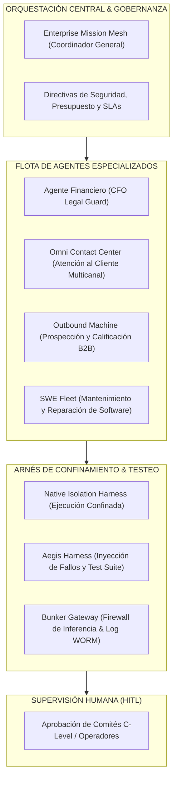

# Workforce AI Hub — Enterprise Multi-Agent Operating Mesh
### Red de Empleados Digitales Autónomos con Gobernanza Centralizada y Aprobación Humana

---

## 1. Resumen Ejecutivo (CEO, COO & Chief Human Resources Officer)

**Workforce AI Hub** representa la siguiente generación de fuerza laboral empresarial: una malla de agentes inteligentes autónomos que asumen roles operativos completos en finanzas, soporte multicanal, prospección comercial e ingeniería de software (SWE Fleet).

Cada agente opera dentro de un entorno confinado sin Docker (**Native Isolation Harness**), con presupuestos de inferencia estrictos y puntos de control donde se requiere aprobación humana vinculante (**Human-in-the-Loop**) antes de ejecutar acciones de impacto patrimonial o reputacional.

---

## 2. Diagrama de la Malla Operativa de Agentes

---

## 3. Principios de Operación y Seguridad

1. **Aislamiento Nativo (Cero Docker)**: Confinamiento de procesos mediante namespaces y sandboxing nativo, reduciendo la superficie de ataque y el consumo de RAM en un 80%.
2. **Evaluación Continua (Aegis Harness)**: Cada agente es sometido a baterías de pruebas adversariales y detección de prompt injection antes de entrar en servicio.
3. **Auditabilidad Criptográfica**: Cada acción, decisión y mensaje queda sellado en un registro de evidencias inmutable con estándar SLSA Provenance.
